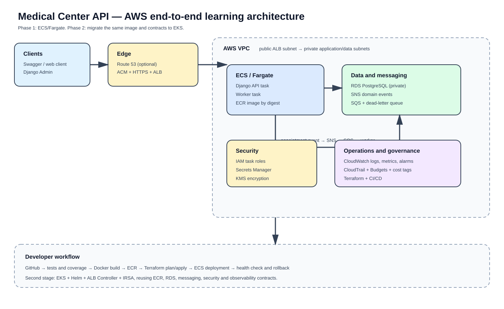

# Medical Center API

Quick guide for starting and verifying the local environment. Use fictional data only.

A Django REST API for managing medical specialists, patients, offices, working schedules, and appointments.

## Architecture

The project is a Python and Django modular monolith. Python is a multi-paradigm language, and this application uses object-oriented programming through Django models, serializers, viewsets, services, and management commands.

The code is organized by domain-oriented Django applications:

```text
specialists   Medical specialties and specialists
patients      Patient records
facilities    Consultation offices
scheduling    Specialist working schedules
appointments  Appointment lifecycle and business rules
```

The project uses selected Domain-Driven Design concepts:

- Entities such as `Patient`, `Specialist`, `Office`, and `Appointment`.
- Bounded-context-oriented Django applications.
- Business rules for availability, appointment intervals, and overlap validation.
- A shared domain vocabulary based on the medical-center operations.

This is not a strict DDD or fully hexagonal architecture. The MVP intentionally keeps Django ORM and Django REST Framework close to the application modules to reduce complexity and make the project easier to run and learn. Dedicated aggregates, value objects, repositories, domain events, and framework-independent domain layers can be introduced if the system grows.

At the current stage, the architecture is:

```text
API / Django REST Framework
        |
Domain-oriented Django applications
        |
Django ORM and migrations
        |
PostgreSQL
```

This structure can evolve toward separate `presentation`, `application`, `domain`, and `infrastructure` layers without changing the external API contract.

## Stack

- Python 3.12
- Django 5.2
- Django REST Framework
- PostgreSQL 16
- Docker Compose
- OpenAPI/Swagger with `drf-spectacular`

## Run locally from scratch

### Requirements

- Docker Desktop with the WSL 2 engine enabled.
- Docker Compose v2.
- Optional: DBeaver for inspecting PostgreSQL.

Start Docker Desktop, then open PowerShell in this repository directory:

```powershell
cd path/to/medical-center-api
```

Create the local environment file:

```bash
cp .env.example .env
```

On Windows PowerShell use:

```powershell
Copy-Item .env.example .env
```

For local development, the values in `.env.example` are sufficient. For any shared or deployed environment, replace the secret key and database password.

Check Docker before starting the project:

```powershell
docker info
docker run hello-world
```

Build and start the application:

```powershell
docker compose up --build
```

The web container waits for PostgreSQL and applies migrations automatically.

Open:

- API: http://localhost:8000/api/v1/
- Health check: http://localhost:8000/health/
- Swagger UI: http://localhost:8000/api/docs/
- OpenAPI schema: http://localhost:8000/api/schema/

### Run in the background

```powershell
docker compose up -d --build
docker compose ps
```

### Create the Django administrator

```powershell
docker compose exec web python manage.py createsuperuser
```

Then open http://localhost:8000/admin/.

## Useful commands

```bash
docker compose up -d --build
docker compose logs -f web
docker compose exec web python manage.py migrate
docker compose exec web python manage.py makemigrations
docker compose exec web python manage.py createsuperuser
docker compose exec web pytest
docker compose exec web pytest --cov=. --cov-report=term-missing
docker compose exec web pytest --cov=. --cov-report=term-missing --cov-report=html
docker compose exec web python manage.py check
docker compose down
```

### Docker image security scan

After building the application image, run Docker Scout to inspect its software components and known CVEs:

```bash
docker compose build web
docker scout cves local://medical-center-api:local
```

The scan is read-only and does not publish the image. Use it before pushing an image to ECR or deploying to AWS. To show only fixable critical and high vulnerabilities:

```bash
docker scout cves --only-fixed --only-severity critical,high local://medical-center-api:local
```

The equivalent Makefile shortcuts are:

```bash
make build
make scan
```

Docker Scout analyzes the image artifact and reports CVEs; a finding must be reviewed before deciding whether to update the base image or Python dependencies. See the [Docker Scout CVE command reference](https://docs.docker.com/reference/cli/docker/scout/cves/).

### Makefile shortcuts

The repository has one `Makefile`; a `justfile` is not required. Use the Makefile from WSL, Git Bash, Linux, or macOS:

```bash
make up
make logs
make migrate
make makemigrations
make test
make check
make createsuperuser
make down
```

PowerShell users can run the equivalent Docker commands shown above, or use `make` from WSL.

Run one focused test:

```bash
docker compose exec web pytest tests/test_health.py
docker compose exec web pytest tests/test_domain_api.py::test_back_to_back_appointments_are_allowed -q
```

Tests use Django's temporary test database with fictional records. They do not use production data or the local PostgreSQL volume.

Run locally with Python 3.12 and PostgreSQL:

```bash
python -m venv .venv
python -m pip install -r requirements.txt
python manage.py migrate
python manage.py check
python -m pytest --cov=. --cov-report=term-missing
python manage.py runserver
```

PowerShell activation:

```powershell
.\.venv\Scripts\Activate.ps1
```

Useful Docker and database commands:

```bash
docker compose up -d --build
docker compose ps
docker compose logs -f web
docker compose logs -f db
docker compose exec web python manage.py showmigrations
docker compose exec web python manage.py makemigrations
docker compose exec web python manage.py migrate
docker compose exec web python manage.py createsuperuser
docker compose exec web sh
docker compose down
```

The `postgres_data` volume preserves local data. Use `docker compose down -v` only when intentionally deleting the local database.
Use `docker compose down -v` only when you intentionally want to delete the local PostgreSQL volume.

## API resources

| Resource | Endpoint |
|---|---|
| Specialties | `/api/v1/specialties/` |
| Specialists | `/api/v1/specialists/` |
| Patients | `/api/v1/patients/` |
| Offices | `/api/v1/offices/` |
| Working schedules | `/api/v1/schedules/` |
| Appointments | `/api/v1/appointments/` |

All resources support standard REST operations. `DELETE` performs logical deactivation for master data and cancellation for appointments.

Appointments require active participants, a valid interval, an active working schedule, and no overlap for the same specialist or office. Back-to-back appointments are allowed.

## PostgreSQL and DBeaver

PostgreSQL runs inside the `db` Docker service. To connect from DBeaver while the service is running, use:

```text
Host:     localhost
Port:     5432
Database: medical_center
Username: medical_center
Password: value of POSTGRES_PASSWORD in .env
```

The Django container uses `db` as the database host because it runs inside the Compose network. DBeaver uses `localhost` because it runs on Windows.

## Migrations and DDL

Django migrations are the authoritative schema definition. Apply them with:

```powershell
docker compose exec web python manage.py migrate
```

After changing models:

```powershell
docker compose exec web python manage.py makemigrations
docker compose exec web python manage.py migrate
docker compose exec web python manage.py makemigrations --check
```

Inspect SQL generated from a migration:

```powershell
docker compose exec web python manage.py sqlmigrate specialists 0001
```

The reference DDL is available at [docs/database/schema.sql](docs/database/schema.sql). It is useful for inspection or database discussions, but it should not replace Django migrations.

## Deployment readiness

### Distroless production image

The project includes a Distroless production image for the Django API. The approach is based on the [GoogleContainerTools/distroless project](https://github.com/GoogleContainerTools/distroless) and uses its official Python runtime image, `gcr.io/distroless/python3-debian13:nonroot`, as the final stage. The goal is to reduce the final image size and runtime attack surface by leaving out the shell, package manager, and build tools.

This project does not copy the Distroless repository. It uses the published Distroless image as a base and adapts the multi-stage build to Medical Center API. Dependencies are installed in a builder image and only the application, Python packages, and runtime are copied into the final image. The regular `Dockerfile` remains the development image used by Docker Compose.

```bash
docker build -f Dockerfile.distroless -t medical-center-api:distroless .
docker scout cves local://medical-center-api:distroless
```

The Distroless build uses Docker's layer cache. Since `requirements.txt` is copied before the application source, unchanged dependencies are reused on subsequent builds. To refresh only the dependency-installation layer, pass a new cache-busting value:

```powershell
docker build -f Dockerfile.distroless `
  --build-arg CACHE_BUST=$(Get-Date -Format yyyyMMddHHmmss) `
  -t medical-center-api:distroless .
```

Use `--no-cache` only when you intentionally need every layer rebuilt:

```powershell
docker build --no-cache -f Dockerfile.distroless -t medical-center-api:distroless .
```

The image runs as the non-root `nonroot` user and uses a vector-form `CMD` because Distroless images do not include a shell or package manager. Migrations must run as a release step from a migration-capable image or job before starting the API. Docker Compose continues to use the regular development image because its entrypoint needs shell tools to wait for PostgreSQL.

Makefile shortcuts:

```bash
make build-distroless
make scan-distroless
```

### AWS end-to-end learning architecture

The planned AWS path starts with ECS/Fargate and later migrates the same application to EKS. It covers networking, IAM, ECR, RDS PostgreSQL, Secrets Manager, KMS, ACM, SQS, SNS, CloudWatch, CloudTrail, Budgets, and Terraform.



See the [AWS end-to-end specification](docs/specs/2026-11-11-aws-end-to-end-design.md), which contains the service matrix and implementation boundaries.

The Docker image is portable to a VM or AWS container service. For non-local environments, inject secrets through the platform, use externally managed PostgreSQL, set `DJANGO_DEBUG=0`, run migrations as a release step, and place the service behind HTTPS. See the guides in `docs/`.

## Stop and reset

Stop containers while preserving PostgreSQL data:

```powershell
docker compose down
```

Delete the local PostgreSQL volume and start from an empty database only when intentionally resetting local data:

```powershell
docker compose down -v
docker compose up --build
```

